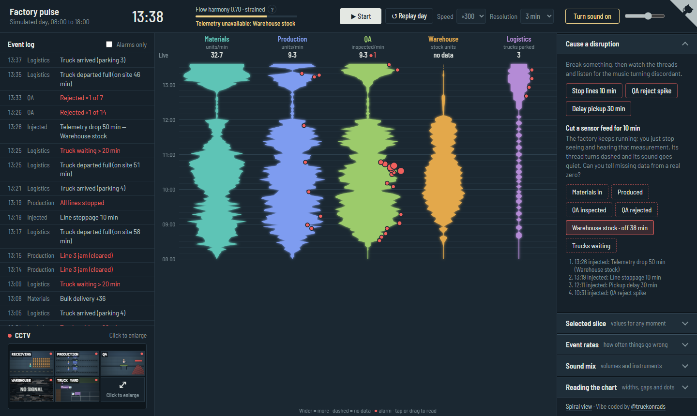
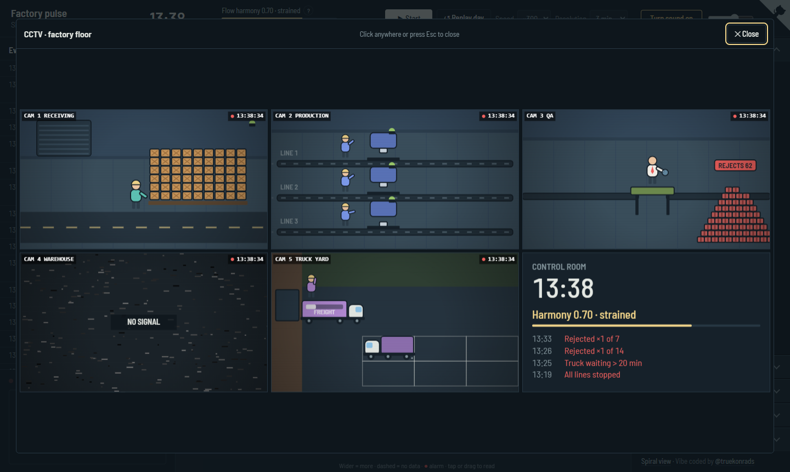
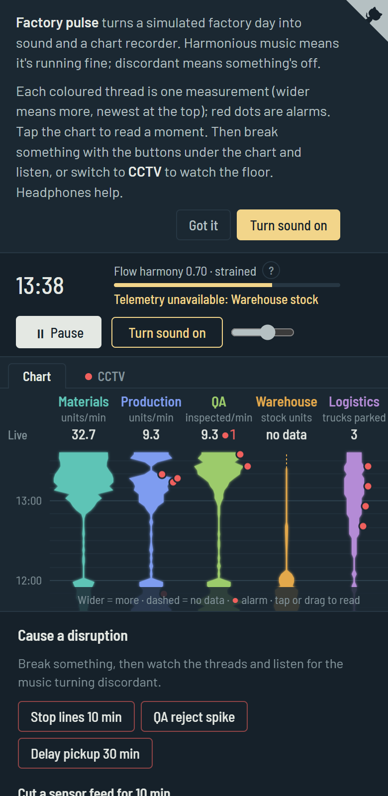

<h1 align="center">Factory pulse</h1>

<p align="center">
  <b>A factory day you can hear and see at a glance.</b><br>
  Harmonious music means it's running fine. Discordant music means something's off.
</p>

<p align="center">
  <a href="https://soundscape.flaminghoops.dev/"><b>▶ Try it live</b></a>
  &nbsp;·&nbsp;
  <a href="#how-to-use-it">How to use it</a>
  &nbsp;·&nbsp;
  <a href="#run-it-yourself">Run it yourself</a>
</p>

<p align="center">
  
</p>

---

## What is this?

Factory pulse is an experiment in **ambient monitoring**. A simulated factory runs through a working day, from 08:00 to 18:00. Materials arrive, three assembly lines build products, QA inspects them and trucks collect them from the warehouse.

Instead of asking you to read dashboards full of numbers, it gives you three ways to take in the factory and leaves your own pattern recognition to do the work:

- **🎧 A soundscape.** Each part of the factory has its own voice, panned left to right along the flow of materials. When everything flows, the music is calm and in key. When things go wrong, it drifts off key, off the beat, and a discordant drone creeps in.
- **📈 A chart recorder.** Five coloured threads scroll down a strip of paper. Wider means more, and red dots mark alarms.
- **📹 CCTV.** Cartoon cameras show each area of the factory floor: trucks tipping crates, belts carrying parts, an inspector tossing rejects onto a growing pile.

After a while you'll know what a normal day looks and sounds like, and you'll notice when something changes, often before you could say what it is.

## How to use it

1. **Press Start** (it starts by itself on phones). The default speed is ×300, so a whole day passes in about two minutes.
2. **Turn sound on.** Headphones help, because the sound pans from left to right along the flow.
3. **Cause a disruption.** Stop the lines, trigger a spike in QA rejects or delay truck pickups, then listen to the music turn sour and watch the threads react.
4. **Watch the harmony score.** *Flow harmony* in the top bar sums everything up, from **1.00** (all flowing) down to **0.00** (badly stuck). Below it, a line names the likely cause.
5. **Compare the views.** Try the same disruption twice: once watching the CCTV, once just listening and following the chart and event log. Which tells you sooner that something's wrong, and what it is?

<table>
  <tr>
    <td width="62%"></td>
    <td></td>
  </tr>
  <tr>
    <td align="center"><sub>CCTV: one camera per area. A cut sensor feed shows as <i>NO SIGNAL</i>.</sub></td>
    <td align="center"><sub>Works on phones too</sub></td>
  </tr>
</table>

## What you're hearing

| Sound | Follows | What changes |
|---|---|---|
| 💧 Water | Materials arriving | Busier stream, more drops |
| 🎹 Chord & bass | Overall production | A gentle chord progression that stalls and detunes under strain |
| 🪕 Line notes | Each of the three lines | One note per unit built, on the beat when healthy. Choose nylon pluck, marimba, felt piano, pad, shaker or kalimba per line |
| 🦗 Crickets | QA inspection cadence | A steady chirp; a gap is easy to hear |
| 🌬️ Wind | Trucks parked in the yard | Rises as trucks queue up |
| 〰️ Discord drone | Overall strain | Fades in as harmony drops |
| 🔔 Knocks & bells | Alarms | A wooden knock for each QA reject, an off-key bowl for other alarms |

Every voice has its own volume slider under **Sound mix**, and your settings are remembered in your browser.

## What you're seeing

| Thread | Measures |
|---|---|
| 🟩 Materials | Units arriving per minute |
| 🟦 Production | Units built per minute across three lines |
| 🟢 QA | Units inspected per minute |
| 🟧 Warehouse | Finished stock on the shelves |
| 🟪 Logistics | Trucks parked, waiting to load |

A hairline is a measured zero and a dashed line means **no data**. Can you tell the difference by ear?

The paper grows downwards like a log, oldest at the top, with a thin white line marking *now*. Press **⇅ Flip** in the chart's top-left corner to put the newest readings on top instead.

## Things to try

- **Stop lines 10 min:** the belts halt, QA runs dry, supplies pile up, and harmony drops within a couple of minutes.
- **QA reject spike:** knocks start sounding and the reject pile grows on camera.
- **Delay pickup 30 min:** the dock closes, trucks pile up in the yard and the wind rises.
- **Cut a sensor feed:** the factory keeps running, but you lose that measurement on the chart, in the sound and on camera.
- **Manual control:** flip the switch from *Homeostasis* to *Manual* to turn off the automatic balancing and see whether the factory recovers on its own. The sliders below it change how often things go wrong.
- **Replay day:** re-runs the same day with the same random seed and your disruptions, so you can compare runs fairly.
- **Spiral view:** an alternative visualisation where each day coils outwards, oldest at the centre. The link is at the bottom of the right-hand column.

## Run it yourself

There's no build step and nothing to install. It's plain HTML, CSS and JavaScript.

```sh
git clone https://github.com/truekonrads/process-soundscape.git
cd process-soundscape
python -m http.server 8000   # or just open index.html in a browser
```

Then open <http://localhost:8000>.

### Deploy to Cloudflare Workers

Deployment uses Node.js and the project-local Wrangler CLI. No site build is needed.

```sh
npm ci
npx wrangler login       # once, if not already authenticated
npm run deploy:check     # validate without publishing
npm run deploy           # publish to the existing old-firefly-23ab Worker
```

Use the Cloudflare account that owns `old-firefly-23ab`. If you have access to
multiple accounts, set `CLOUDFLARE_ACCOUNT_ID` to that account's ID before deploying.
For example, in PowerShell: `$env:CLOUDFLARE_ACCOUNT_ID = "your-account-id"`.

`wrangler.jsonc` serves the repository root as static assets. `.assetsignore`
allows only the two HTML pages, their JavaScript, and the site images/icons;
README, `docs/`, dependencies, and repository/configuration files are not uploaded.
Add any new public assets to that allowlist before deploying.

For a local preview using Cloudflare's asset routing, run `npm run dev`.

### What's inside

| File | What it does |
|---|---|
| `index.html` | The main page: layout, chart recorder, controls and the intro |
| `core.js` | The shared engine: a deterministic factory simulation, the harmony score and the Web Audio soundscape |
| `cctv.js` | The cartoon CCTV feeds, drawn on a canvas from the simulation's live state |
| `spiral.html` | The alternative spiral visualisation |

The simulation is seeded, so the same day plays out identically every time unless you step in. Sound is generated live with the Web Audio API; there are no audio files. The CCTV is drawn live on a canvas from the simulation's state; there are no images.

## Credits

Vibe coded by [@truekonrads](https://x.com/truekonrads).

## License

[MIT](LICENSE). Use it, remix it, build on it.
